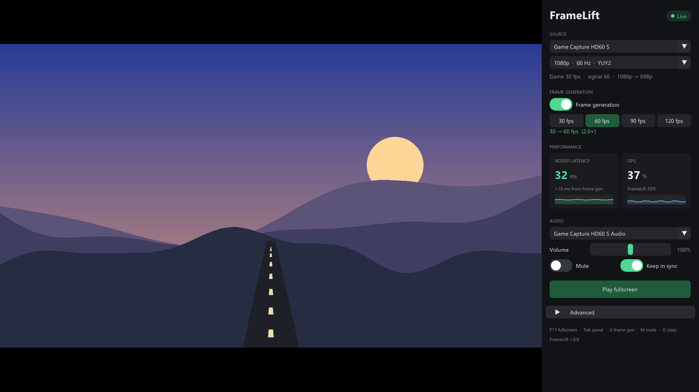
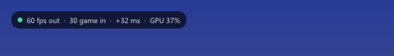

# FrameLift

**Play your console at a higher frame rate through a capture card.** FrameLift takes the video from an HDMI capture card, generates in-between frames on your PC's GPU, and shows it fullscreen with the card's audio. A PS5 game locked at 30 fps comes out at a smooth 60. FrameLift keeps the added latency as low as it can, and shows exactly how much latency it adds, measured on every frame.



**[Download the latest release](https://github.com/Parker-LaBonte/FrameLift/releases/latest)**: run `FrameLift-Setup-<version>.exe`. It doesn't need administrator rights.

## What you need

- A console (PS5, PS4, Xbox, Switch, anything with HDMI) and an **HDMI capture card**: Elgato (HD60 S/X, 4K X, Neo), AVerMedia, or most USB HDMI capture devices.
- **Windows 10 or 11, 64-bit**, with a **DirectX 11 GPU**. NVIDIA GTX 16-series and RTX cards use their optical-flow hardware for the best quality. Other GPUs use a shader-based motion search.
- Windows "N" editions also need the free Media Feature Pack. The installer checks for it.

Interpolation needs the *next* real frame before it can draw the one in between, so frame generation always adds some delay. For 30 → 60 fps that's about one game frame, typically 10–20 ms on top of the capture path. That works well for adventure, racing and sports games. For competitive shooters, turn frame generation off (press **G**) and FrameLift becomes a plain low-latency viewer.

## Quick start

1. Connect console → capture card → PC. Close OBS, Elgato Studio, or anything else using the card, because Windows lets only one app use it at a time.
2. Open FrameLift. It finds the card on its own (hot-plugging works too), and plays the card's audio through your speakers.
3. Pick a target (60 fps by default) and click **Play fullscreen** (or press **F11**).

| Key | Action |
|---|---|
| F11 / Alt+Enter / double-click | Fullscreen on/off |
| Esc | Leave fullscreen |
| Tab | Show/hide the panel |
| G | Frame generation on/off |
| M | Mute |
| O | Stats line in fullscreen |

In fullscreen, the stats line shows output fps, the game's real fps, added latency and GPU load:



## Features

- **Detects the real game frame rate, live.** A PS5 game running at 30 fps still sends a 60 Hz signal, with every frame repeated. FrameLift drops the repeats before doing any work, and fills in exactly as many frames as needed to reach the target. When the game dips, slows down, or runs at 60 in menus, it adapts.
- **Measured latency.** For each frame: from the card delivering it to the refresh where it reached your screen (DXGI frame statistics). The panel shows what frame generation adds on top.
- **Any capture size.** 1080p, 1440p and 4K captures, scaled to your screen with an edge-preserving resampler and adaptive sharpening (the approach of AMD FSR 1's RCAS).
- **HDR capture** (10-bit HDR10/HLG, e.g. from 4K cards) is tone-mapped to SDR.
- **Seamless audio.** The card's own audio device is found automatically and played with low-latency WASAPI. Optionally it's delayed to stay in sync with the picture.
- **NVIDIA hardware optical flow** (Turing and newer) via CUDA–D3D11 interop: frames never leave the GPU.
- **Menus and HUDs stay crisp.** Pixels that don't change between two real frames are shown exactly as they are.

## Settings

Everything is on the panel (**Tab**). Under **Advanced**:

- **VSync** (on): no tearing; output snaps to your display's refresh. Off gives exact targets and the lowest latency, which is best on G-Sync/FreeSync displays.
- **Late present** (on): picks the moment to show just before each refresh, for about 10 ms less latency.
- **Pacing**: *lowest latency* (default) or *smoothest* (+1 frame).
- **Scaling**: *sharp* (default) or *bilinear*, plus a sharpening amount.
- **Start with Windows**: opens FrameLift fullscreen when you sign in.
- **Keep GPU at full speed** (NVIDIA): sets "Prefer maximum performance" in FrameLift's own driver profile. Without it the GPU down-clocks under FrameLift's light load and motion analysis runs about twice as slow. The uninstaller removes it.

Settings and logs are kept in `%APPDATA%\FrameLift`.

## Troubleshooting

- **"Windows protected your PC" when installing:** the installer isn't code-signed yet. Click **More info → Run anyway**.
- **"Card busy":** another app (OBS, Elgato Studio, Discord streaming, a browser tab with camera access) is using the card. Close it, and FrameLift reconnects by itself.
- **Audio plays twice:** Windows "Listen to this device" is on for the card. FrameLift switches it off while it runs and restores it on exit. If you still hear doubled audio, turn it off under Sound settings → More sound settings → Recording → the card → Properties → Listen.
- **Output lower than the target:** with VSync on, output snaps to what your display's refresh allows (the panel says so). For example, a 90 fps target on a 60 Hz screen gives 60. Use a higher refresh mode, or turn VSync off.
- **A log for bug reports:** `%APPDATA%\FrameLift\log.txt`.

## How it works

1. **Capture**: Media Foundation reads the card. Each frame is compared with the last on a sparse 128×72 grid *before* it's copied, so repeated frames cost almost nothing.
2. **Motion**: for every pair of real frames, motion is estimated on a reduced-size copy (about 960×540 at any capture size). On NVIDIA this uses the optical-flow hardware, and elsewhere a coarse-to-fine block search with per-pixel refinement. It runs asynchronously, so it never delays a frame that doesn't need it.
3. **Timeline**: output frames are placed on a real timeline, not a fixed 2× pattern, so 30→60, 30→90, 40→120 and uneven pacing all work. The hold (how far behind live the picture runs) is one game frame minus one output frame plus a small adaptive margin, about 17–30 ms for 30→60. With VSync it shifts so that a refresh lands exactly on each real frame.
4. **Draw**: each output frame warps both neighbouring real frames to the exact display moment and blends them at capture resolution, then scales once to your screen.

The quality settings were tuned with a built-in benchmark (`FrameLift.exe --bench <clips> --configs <file> --out <csv>`). It takes true 60 fps gameplay, drops every other frame, regenerates it, and scores the result against the real frame (PSNR, SSIM, worst tiles).

## Build from source

Cross-compile from macOS or Linux (`brew install mingw-w64 cmake ninja makensis`):

```
cmake -B build-mingw -G Ninja -DCMAKE_TOOLCHAIN_FILE=cmake/mingw-w64.cmake -DCMAKE_BUILD_TYPE=Release
ninja -C build-mingw
tools/make_installer.sh        # also builds dist/FrameLift-Setup-<version>.exe
```

On Windows, use [MSYS2](https://www.msys2.org/) (UCRT64): `pacman -S mingw-w64-ucrt-x86_64-{gcc,cmake,ninja,nsis}`, then the same `cmake`/`ninja` commands without the toolchain file. CI does exactly this (`.github/workflows/build.yml`).

The result is one self-contained `FrameLift.exe`. Shaders are compiled at startup by `d3dcompiler_47.dll`, which ships with Windows.

For UI work, `FrameLift.exe --uishot out.png --frame image.png [--state live|nosignal|nodevice|busy] [--fullscreen --nodash] [--advanced] [--dpi 1.5]` renders the interface with demo data, with no capture card needed.

## Status and known limits

- Developed and tested on an Elgato HD60 S (1080p60) with a PS5 and a GTX 1650 Super. The 1440p/4K, HDR and non-NVIDIA paths are verified with the benchmark but not yet on real hardware. Reports are very welcome.
- Interpolation can show artifacts where things appear from behind other things (disocclusion), around thin fast-moving objects, and across scene cuts.
- A 59.94 Hz console on a 60.00 Hz display with VSync on slips one frame about every 16 s. Every capture viewer has this. Setting the display to 59.94 Hz, or using VRR with VSync off, avoids it.

## License

MIT, see [LICENSE](LICENSE). Third-party components are listed in [installer/THIRD_PARTY_NOTICES.txt](installer/THIRD_PARTY_NOTICES.txt).

FrameLift is an independent project, not affiliated with Sony, Microsoft, Nintendo, Elgato, AVerMedia, NVIDIA or AMD. Product names are used only to describe compatibility.
